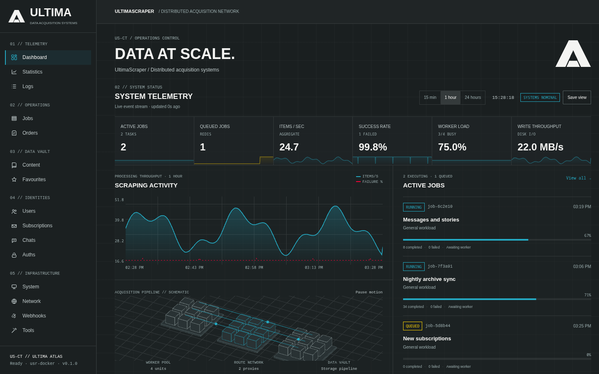
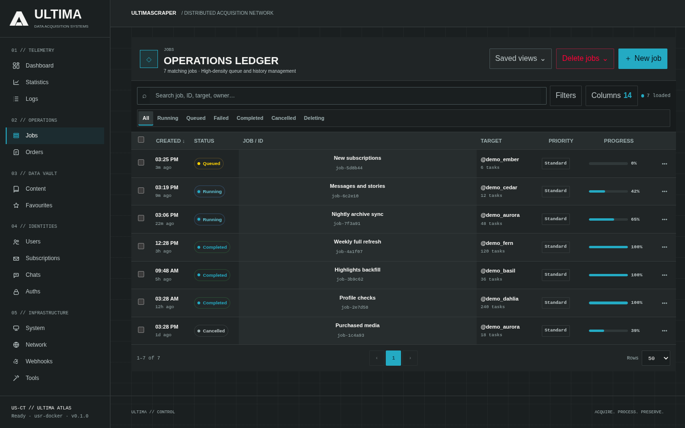
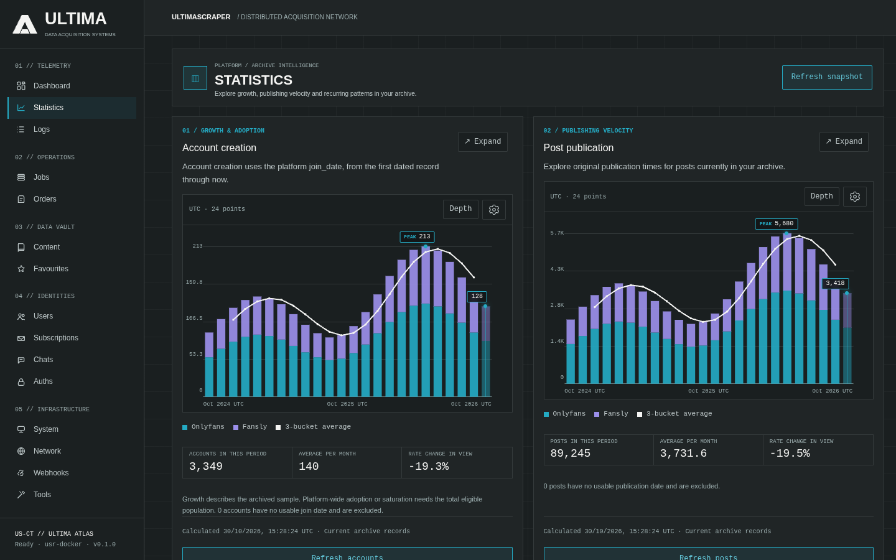
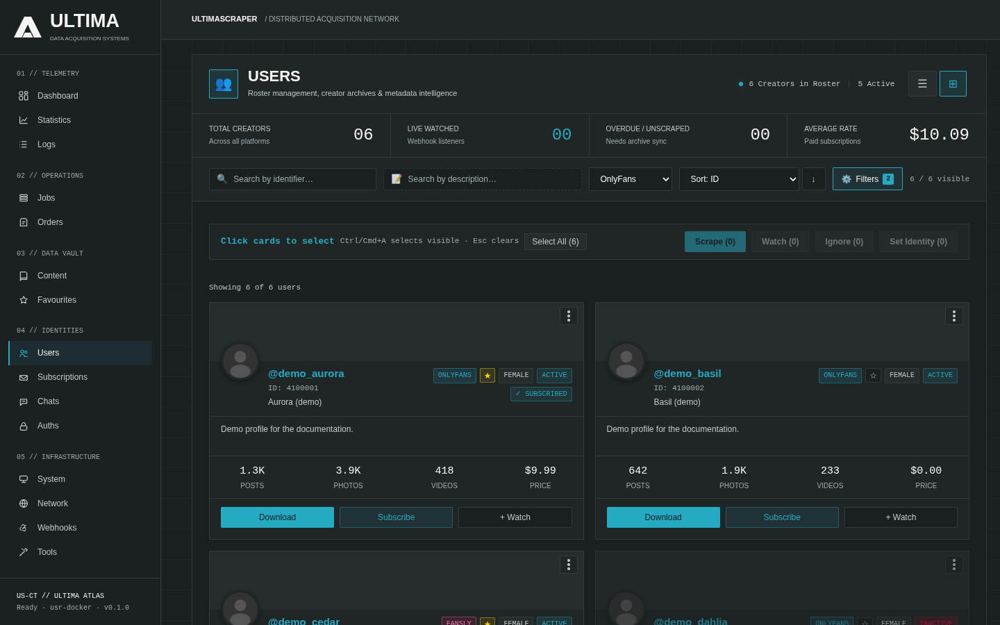
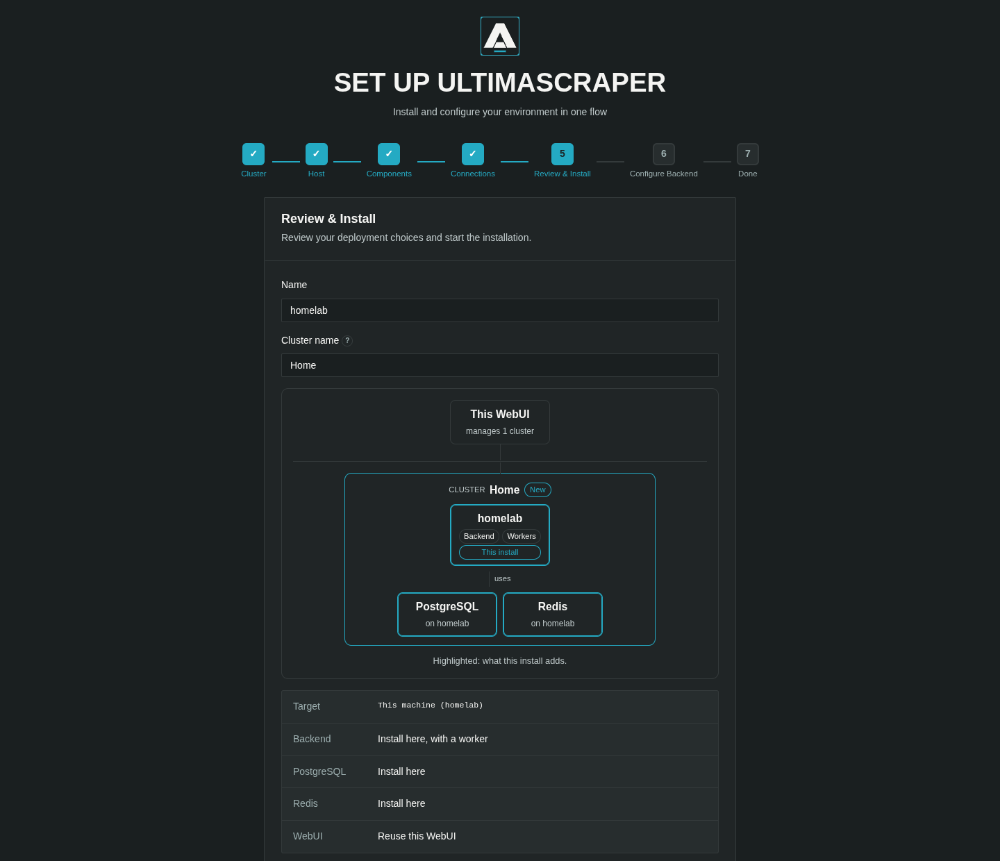

# 🗄️ UltimaScraper

<a href="https://buymeacoffee.com/datahoarders" target="_blank" rel="noopener noreferrer"></a>
<a href="https://www.webshare.io/?referral_code=s8w96gu8w77g" target="_blank" rel="sponsored noopener noreferrer"></a>

**Your creator archive, on autopilot.** UltimaScraper saves the posts, messages,
stories and media from the creators you follow on OnlyFans, Fansly and LoyalFans,
and gives you a beautiful dashboard to run it all from your browser.



<table>
  <tr>
    <td><a href="docs/assets/screenshots/jobs.png"></a><br><sub>⚡ Jobs: the queue and its history</sub></td>
    <td><a href="docs/assets/screenshots/statistics.png"></a><br><sub>📊 Statistics: how your archive grows</sub></td>
  </tr>
  <tr>
    <td><a href="docs/assets/screenshots/users.png"></a><br><sub>👥 Users: creators and their archives</sub></td>
    <td><a href="docs/assets/screenshots/setup-review.png"></a><br><sub>🧙 Setup wizard: up and running in a few clicks</sub></td>
  </tr>
</table>

<sub>Screenshots use made-up demo data.</sub>

## ✨ Features

- 🖥️ **Everything in your browser.** Queue jobs, browse your library and manage
  accounts from one dashboard. No command line needed.
- 📥 **Grab it all.** Timeline and archived posts, stories and highlights,
  messages with their attachments, and recorded streams.
- ⚡ **Fast and parallel.** Workers download many creators at once, and new
  work slots in the moment a download finishes.
- 🔁 **Pick up where you left off.** Failed items retry with one click, and a
  crashed worker's tasks go straight back in the queue.
- 🖼️ **A library you'll actually use.** Search captions and messages, filter by
  creator, type or date, and preview photos, videos and audio right in the page.
- 📊 **See your archive grow.** Charts of new accounts, posting activity and
  busiest hours, days and months, per site.
- 📡 **Live dashboard.** Watch jobs, workers, throughput and disk space update
  in real time.
- 🧙 **Guided setup.** A wizard installs everything on this machine, or on
  another one over SSH, and checks it as it goes.
- 🌐 **Grow to many machines.** Add more servers and workers whenever you like,
  run them as one cluster, and invite other dashboards to share it.
- 💾 **Storage aware.** Spread your archive over several drives, with warnings
  before one fills up.
- 🔔 **Webhooks and plugins.** Get notified when things happen, and extend
  UltimaScraper with plugins.
- 🔐 **Private by design.** It runs on your own hardware, protects the
  dashboard with a password, and keeps saved logins encrypted.

## 🚀 Quick start

You need [Docker](https://docs.docker.com/get-docker/) with Compose.

```bash
git clone https://github.com/UltimaHoarder/UltimaScraper.git
cd UltimaScraper
cp .env.example .env
```

Open `.env` and set `POSTGRES_PASSWORD` and `REDIS_PASSWORD` to long random
values (`openssl rand -hex 24` makes a good one). Then start it:

```bash
docker compose up -d
```

🎉 Open **http://localhost:21120**, choose a password, and the setup wizard
takes it from there. If you open it from another device, enter the setup code
that `docker compose logs webui` prints.

> [!IMPORTANT]
> UltimaScraper creates an encryption key on first start. Back it up: your saved
> logins can't be read without it. The [Docker guide](docs/operations/docker.md)
> shows where it lives.

## 📚 Learn more

The full documentation is at [ultimahoarder.github.io/UltimaScraper](https://ultimahoarder.github.io/UltimaScraper/).

- 🏁 [Quick start guide](docs/getting-started/quickstart.md)
- 🧭 [Using the WebUI](docs/user-guide/webui-overview.md)
- ⚡ [Running jobs](docs/user-guide/job-management.md)
- 🔑 [Accounts and creators](docs/user-guide/accounts-profiles.md)
- 🐳 [Docker guide](docs/operations/docker.md)
- ⬆️ [Upgrading](docs/operations/upgrades.md)
- 🛠️ [Developing UltimaScraper](docs/getting-started/native-development.md)

## ⚖️ Use responsibly

Only archive content you have legitimate access to, and respect creators and
each site's terms. You are responsible for how you use UltimaScraper.

## ☕ Support

If you find UltimaScraper helpful, consider supporting the project:

<a href="https://buymeacoffee.com/datahoarders" target="_blank" rel="noopener noreferrer"></a>

🌐 **Need proxies?** UltimaScraper can spread its work over proxies from the
**Network** page. Sign up for [Webshare](https://www.webshare.io/?referral_code=s8w96gu8w77g) through our affiliate link and
**you'll get 10 free proxies** to see how much they help. It supports the project
at no extra cost to you.

> **What I use:** I've personally scraped **500 million public OnlyFans profiles in two to three months**
> with UltimaScraper's [Mass Profile Scraper](docs/user-guide/mps.md) (**Tools → Mass Profile Scraper**) and this
> Webshare setup, for around **$30**:
>
> - Proxy server: **Shared**
> - **250 proxies**
> - **5,000 GB** bandwidth
> - **High concurrency**

<a href="https://www.webshare.io/?referral_code=s8w96gu8w77g" target="_blank" rel="sponsored noopener noreferrer"></a>

## 📄 License

UltimaScraper is released under the [MIT License](LICENSE). Found a security
issue? See [SECURITY.md](SECURITY.md).
