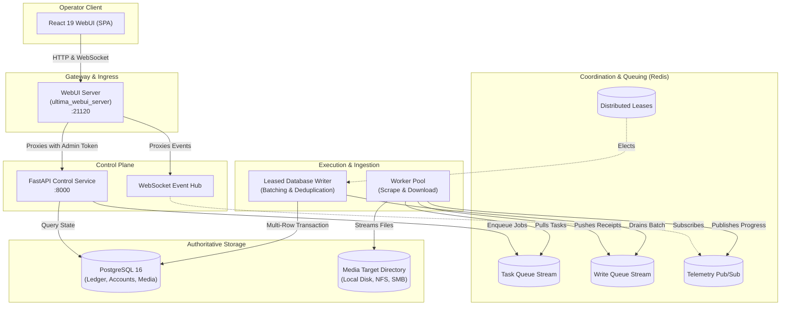
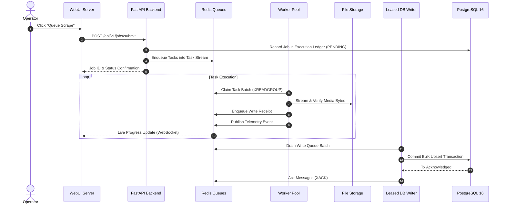

# System Architecture Overview

UltimaScraper is architected as an event-driven, distributed scraping and archival control plane. It decouples high-bandwidth network scraping from persistent database writes to ensure maximum throughput and stability.

---

## Architectural Topology

---

## Lifecycle of a Scrape Job

The execution of a scrape workflow follows a multi-stage pipeline:

---

## Subsystem Responsibilities

### 1. WebUI Server (`ultima_webui_server`)
- Authenticates operators using HTTP-only session cookies.
- Proxies requests to local or remote backends, injecting admin bearer tokens.
- Manages SSH tunnels and provides single-click remote backend deployments.

### 2. FastAPI Control Service
- Publishes OpenAPI specifications at `/docs` and `/openapi.json`.
- Dispatches scrape tasks to Redis streams based on job schedules and profile priorities.
- Coordinates worker scaling and health heartbeats.

### 3. Redis Queue & Event Broker
- Acts as a high-speed buffer preventing slow disk writes from throttling fast network scraping.
- Broadcasts real-time download velocities, worker counts, and errors to browser clients.

### 4. Leased Database Writer
- Consolidates writes into efficient batch transactions.
- Provides automatic deduplication, retry exponential backoff, and dead-letter handling.

### 5. PostgreSQL Authoritative Storage
- Maintains immutable audit trails of all scraped posts, messages, stories, and media items.
- Preserves referential integrity across performers, subscriptions, and download paths.
