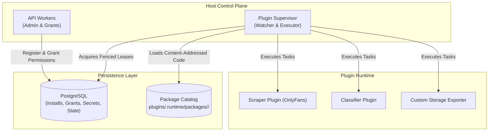

# Plugin SDK & Runtime Architecture

UltimaScraper features a modular plugin runtime enabling platform scrapers, custom post-processors, and WebUI interface extensions to be installed, configured, and upgraded without restarting core services.

---

## Architecture & Persistence

The plugin architecture relies on PostgreSQL as its authoritative state machine and Redis for event dispatching:



- **Database-Backed State**: Plugin installations, configuration options, permission grants, managed secrets, event cursors, and delivery queues reside in dedicated PostgreSQL tables.
- **Dedicated Supervisor**: A specialized supervisor daemon runs reconciliation loops, watches for new packages, and dispatches background plugin tasks. In production, run the supervisor alongside workers:
  ```bash
  python -m ultima_scraper_backend.plugin_system.supervisor
  ```
- **Content-Addressed Package Catalog**: Plugins are stored as immutable snapshots under `plugins/.runtime/packages/<plugin_id>/<digest>`. The active version pointer is recorded in PostgreSQL.

---

## Plugin Manifest (Schema v2)

Every plugin defines a `manifest.yaml` (or `manifest.json`) declaring its identity, permissions, and configuration schema:

```yaml
manifest_schema_version: 2
plugin_id: media-classifier
plugin_version: 1.0.0
display_name: Media Classifier
capabilities:
  - jobs.submit
  - webui.extend
  - profiles.read
  - state.read
  - state.write

sdk:
  compatibility: '>=1.0.0,<2'
  configuration_schema:
    type: object
    properties:
      service_url:
        type: string
        format: uri
        default: 'https://classifier.example.internal'
      confidence_threshold:
        type: number
        default: 0.85
    additionalProperties: false

  access:
    profile_fields:
      - name
      - description
      - user_id
      - site
    task_types:
      - classifier.predict
    outbound_domains:
      - classifier.example.internal
    state_keys:
      - checkpoint

  ui:
    - contribution_id: classifier-panel
      slot: user.profile.panels
      title: Classification Insights
      entrypoint: dist/panel.js
```

---

## Capabilities & Permissions

Plugins operate under the principle of least privilege. The runtime restricts plugin access according to explicitly granted capabilities:

| Capability | Description |
|---|---|
| `jobs.submit` | Authorizes the plugin to queue scrape or download jobs. |
| `webui.extend` | Permits the plugin to mount visual UI panels and tabs into the WebUI. |
| `profiles.read` | Grants read access to performer profile metadata. |
| `state.read` / `state.write` | Grants access to namespaced persistent key-value state in PostgreSQL. |
| `secrets.manage` | Allows reading securely encrypted API keys and access tokens. |
| `events.subscribe` | Authorizes listening to live scraper event streams. |

---

## WebUI Extension Slots

Plugins declaring the `webui.extend` capability can register UI components for insertion into predefined application slots:

- `user.profile.panels`: Custom cards and analytics embedded into performer profile pages.
- `jobs.detail.tabs`: Diagnostic views and reporting tabs within job inspection modals.
- `navigation.sidebar`: Top-level navigational items in the main application drawer.
- `settings.tabs`: Dedicated configuration pages in the settings portal.
