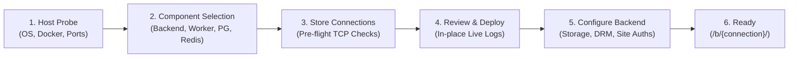

# Getting Started Overview

UltimaScraper features an automated, browser-driven setup experience powered by the **Unified Setup Wizard (`/setup`)**. Whether deploying a multi-container Docker fleet across multiple servers or running locally from source for development, setup is guided and verified in real time.

---

## Choosing Your Deployment Method

| Deployment Path | Best For | Prerequisites | How It Works |
|---|---|---|---|
| **[Docker Quickstart (Recommended)](quickstart.md)** | Production, Homelabs, NAS setups | Docker 24+, Docker Compose v2 | Pull release images and run the unified stack or let the WebUI installer provision services automatically. |
| **[Native Development](native-development.md)** | Core Developers, Plugin Authors | Python 3.14, Node.js 20+, `uv` | Runs editable repository checkouts with Python 3.14, Vite frontend hot-reloading, and native `main.py`. |

---

## How Guided Setup Works (`/setup`)

When you first open UltimaScraper in your browser (at `http://localhost:21120` in Docker or `http://localhost:21120` in native development), the application detects whether any backends are configured. If not, it automatically redirects you to the **Unified Setup Wizard**:

1. **Host Detection**: Probes the system (architecture, Docker daemon, sudo requirements, existing ports `5432`/`6379`).
2. **Component Matrix**: Pick what to run (`Backend`, `Worker`, `PostgreSQL`, `Redis`, `WebUI`). Supports bundled containers or existing external services.
3. **Pre-Flight Service Checks**: Tests PostgreSQL and Redis reachability *before* any installation is started.
4. **Review & Deployment**: Generates cryptographic secrets, sets up containers, and streams installation logs directly into the browser.
5. **Inline Backend Configuration**: Configures media storage directories, DRM (Widevine CDM device registration), site authentications (OnlyFans, Fansly, LoyalFans), and network settings—all in the same continuous flow without page redirects.
6. **Launch**: Opens your freshly initialized control plane.

---

## Next Steps

- **Ready to deploy containers?** Follow the **[Docker Quickstart](quickstart.md)**.
- **Developing locally or building plugins?** Follow the **[Native Development Guide](native-development.md)**.
- **Want to understand component rules and remote SSH provisioning?** Read the **[Setup Wizard & Installer Guide](../operations/installer.md)**.
