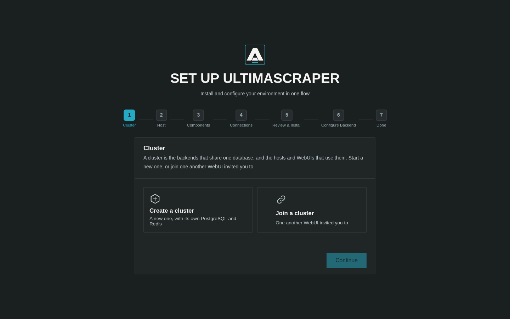
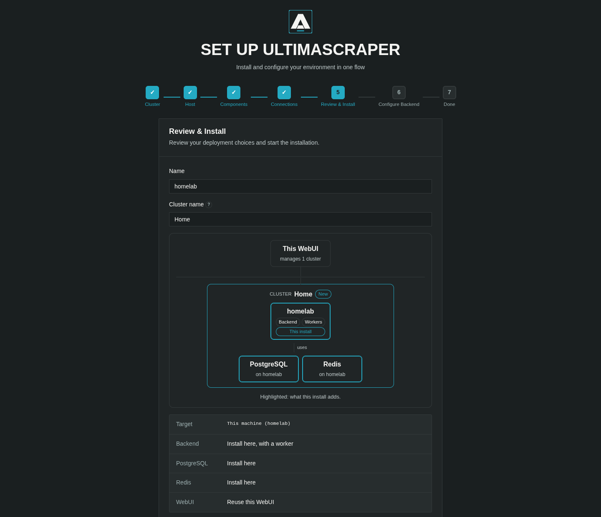

# Quickstart with Docker

Deploy a complete UltimaScraper fleet in under five minutes.

UltimaScraper offers two straightforward Docker deployment paths:
- **Path A: All-in-One Compose (Standard)** — Boots WebUI, API, workers, PostgreSQL, and Redis via Docker Compose.
- **Path B: WebUI-Driven Installer (Zero-Config)** — Launches a lightweight WebUI container that automatically provisions and manages backends on this machine or remote hosts over SSH.

---

## Path A: All-in-One Docker Compose

### 1. Clone Configuration & Generate Secrets
Clone the repository and prepare your deployment `.env` file:

```bash
git clone https://github.com/UltimaHoarder/UltimaScraper.git
cd UltimaScraper
cp .env.example .env
```

You can automatically populate all cryptographic keys, admin bearer tokens, and store passwords using the bootstrap tool:

```bash
uv run python -m ultima_scraper_backend.bootstrap --compose --env-file .env
```

*Or manually edit `.env` and set strong random passwords for `POSTGRES_PASSWORD` and `REDIS_PASSWORD`.*

### 2. Pull and Start Services
Start all containers in detached mode:

```bash
docker compose pull
docker compose up -d
```

### 3. Open WebUI & Create Administrator Password
1. Navigate to **`http://localhost:21120`** in your browser.
2. The initial browser connection on your local network will prompt you to create the WebUI administrator password.
   > [!NOTE]
   > If accessing remotely through a reverse proxy or VPN, retrieve the single-use setup code from the container logs:
   > ```bash
   > docker compose logs webui | grep -i "setup code"
   > ```
3. Once your password is set, the **Unified Setup Wizard** opens automatically to finalize your backend configuration.



---

## Path B: WebUI-Driven Installer (Browser Guided)

If you prefer to let the WebUI handle Docker provisioning, container lifecycle, and updates without touching Compose files manually:

### 1. Launch the Standalone WebUI Gateway

```bash
docker run -d \
  --name usr-webui \
  -p 21120:21120 \
  -v usr_webui:/data \
  --add-host host.docker.internal:host-gateway \
  ghcr.io/ultimahoarder/ultimascraper/webui:0.1.0
```

### 2. Complete the Unified Setup Wizard at `/setup`

Open **`http://localhost:21120`**, create your password, and the **Unified Setup Wizard** guides you through:

```
┌────────────────────────────────────────────────────────────────────────┐
│  Host  ──>  Components  ──>  Connections  ──>  Deploy  ──>  Configure  │
└────────────────────────────────────────────────────────────────────────┘
```



1. **Host Detection**: Automatically probes Docker Engine version, CPU architecture (`amd64` / `arm64`), sudo requirements, and checks if port `5432` (Postgres) or `6379` (Redis) are already listening.
2. **Component Selection**: Select what you want to run:
   - **Backend & Worker**: Choose `install here` or distribute workers across separate nodes.
   - **PostgreSQL & Redis**: Choose `bundled container` (isolated) or `existing` (connect to an external database). An existing PostgreSQL must have [pgvector](../operations/docker.md#postgresql-requirements-pgvector) installed; the bundled one already does.
3. **Pre-flight Service Checks**: If using external databases, the **Check** button tests live TCP reachability from the target host before any deployment proceeds.
4. **Deploy**: Reviews selections, prompts for a sudo password only if required by system permissions, and streams installation logs in real time.
5. **Inline Backend Configuration**:
   - **Storage & Paths**: Choose directories for downloaded media, temporary buffers, and staging.
   - **DRM Configuration**: Register Widevine Content Decryption Modules (CDM) for protected media playback/download.
   - **Site Authentications**: Input login sessions for supported platforms (OnlyFans, Fansly, LoyalFans).
6. **Done**: The wizard opens your ready-to-use backend at `/b/{connection_id}/`.

---

## Managing Your Deployments

After setup, manage all deployments directly in the WebUI:
- Open **Manage Backends** in the header.
- View real-time service health, repair stopped containers, trigger one-click image upgrades, or provision additional worker nodes across your network over SSH.

For in-depth details on component combinations and SSH provisioning, see the **[Setup Wizard & Installer Guide](../operations/installer.md)**.
