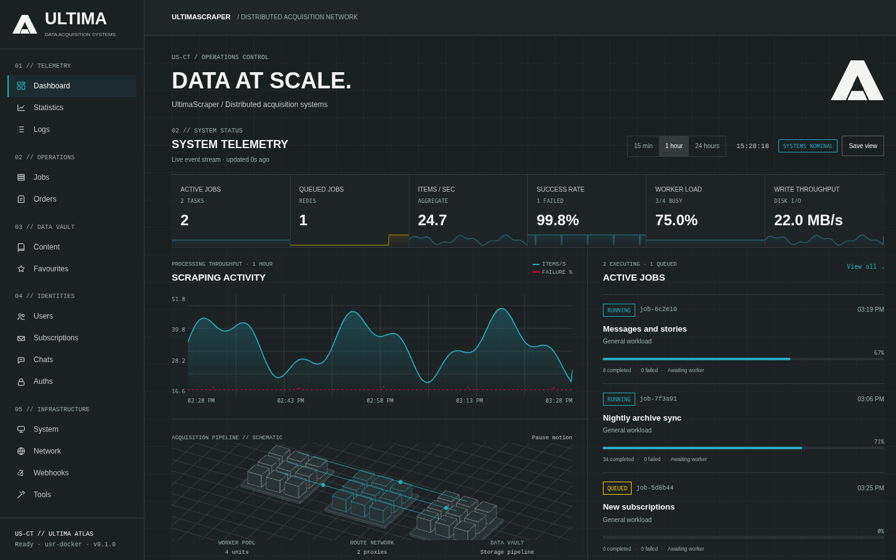
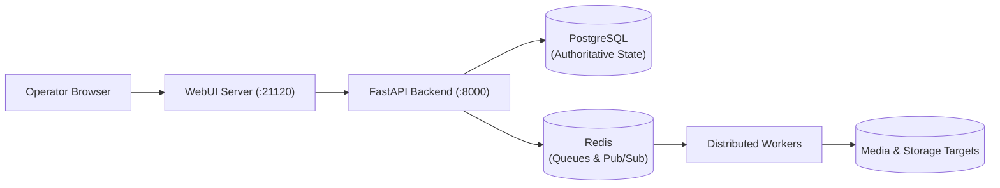

# UltimaScraper

**UltimaScraper (USR)** is a WebUI-first control plane for scraping workflows, media archiving, account sessions, storage targets, and distributed worker execution.

Designed for resilience and scale, UltimaScraper pairs an asynchronous FastAPI control plane with a React operator interface, authoritative PostgreSQL database storage, and Redis event queues.





---

## Core Tenets & Architecture Contract

- **WebUI-First Operator Interface**: Built with React and Vite, the WebUI provides real-time job execution telemetry, interactive database inspection, remote host deployment, and account session management.
- **FastAPI Control Plane**: Python 3.14 asynchronous backend providing an OpenAPI-documented REST and WebSocket surface. Hand-maintained endpoint tables are replaced by dynamic `/docs` and `/openapi.json` schemas.
- **Authoritative PostgreSQL Storage**: PostgreSQL 16 is the single authoritative source of truth for all schemas, profiles, subscriptions, media archives, and execution ledgers. SQLite is accepted solely as a legacy migration adapter.
- **Redis Queueing & Live Events**: Redis coordinates distributed job locks, worker task assignment, live WebSocket telemetry broadcasts, and write-queue buffering.
- **Strict Separation of Concerns**: API, Worker, and WebUI containers run as independent, non-root runtimes that scale horizontally across single-node or multi-node server clusters.

---

## Documentation Roadmap

```
├── Getting Started
│   ├── Overview                  — Understanding deployment options
│   ├── Quickstart with Docker    — 5-minute container deployment & setup wizard
│   └── Native Development        — Running locally with Python 3.14, uv, and Vite
├── User Guide
│   ├── Overview                  — WebUI operator concepts and navigation map
│   ├── WebUI & Multi-Backend     — Multi-backend switcher, clusters, and failover
│   ├── Profiles & Auths          — Platform sessions, guest pools, and subscriptions
│   ├── Job Execution & Telemetry — Submitting tasks, live metrics, and diagnostics
│   ├── Content & Media Explorer  — Browsing feeds, content cards, and DRM playback
│   ├── Multi-Performer Streaming — High-scale MPS workflows and capacity tools
│   └── Database Maintenance      — Table inspection, PostgreSQL VACUUM, and drives
├── Operations
│   ├── Docker & Containers       — Multi-container topology, profiles, and persistence
│   ├── Setup Wizard & Installer  — Guided 6-stage setup, host probing, and SSH fleets
│   ├── WebUI Server              — Proxy mechanics, clustering, and remote SSH deploys
│   ├── Security & Auth           — Hardened tokens, encryption keys, and network bounds
│   ├── Database Writer           — Asynchronous write queues, leases, and ledger writes
│   ├── Upgrades & Migrations     — Database schema upgrades, backups, and recovery
│   └── Release Candidate         — Quality gates, acceptance tests, and checklists
├── Architecture
│   ├── System Architecture       — End-to-end component lifecycle and data flow
│   └── Plugin System             — Manifest v2 SDK, supervisor leases, and contributions
└── Reference
    ├── Environment Variables     — Exhaustive runtime and resource tuning parameters
    └── License                   — AGPL-3.0-or-later and copyright information
```

---

## Next Steps

- Jump straight into deployment with the [Quickstart with Docker](getting-started/quickstart.md).
- Looking to contribute or hack on the core? Follow the [Native Development Guide](getting-started/native-development.md).
- Review container profiles and multi-host setups in the [Docker Guide](operations/docker.md).

---

## Support the project

If UltimaScraper is useful to you, you can help keep it going:

- ☕ **[Buy us a coffee](https://buymeacoffee.com/datahoarders){ target="_blank" rel="noopener" }**.
- 🌐 **Need proxies?** Sign up for [Webshare](https://www.webshare.io/?referral_code=s8w96gu8w77g){ target="_blank" rel="sponsored noopener" } through our affiliate link and you'll get **10 free proxies** to see how much they help. It costs you nothing extra and supports the project.

> **What I use:** I've personally scraped **500 million public OnlyFans profiles in two to three months**
> with UltimaScraper's [Mass Profile Scraper](user-guide/mps.md) (**Tools → Mass Profile Scraper**) and this
> Webshare setup, for around **$30**:
>
> - Proxy server: **Shared**
> - **250 proxies**
> - **5,000 GB** bandwidth
> - **High concurrency**

<a href="https://buymeacoffee.com/datahoarders" target="_blank" rel="noopener noreferrer"></a>
<a href="https://www.webshare.io/?referral_code=s8w96gu8w77g" target="_blank" rel="sponsored noopener noreferrer"></a>
