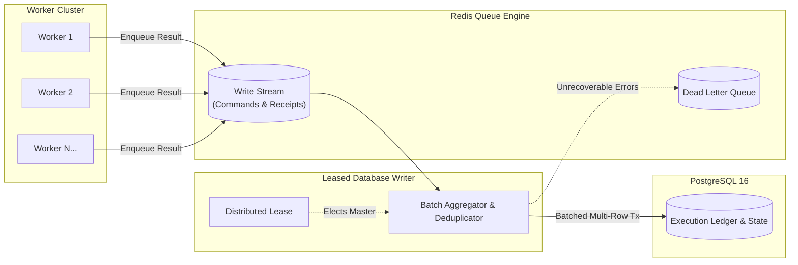

# Database Writer Architecture

In large-scale scraping operations with tens or hundreds of concurrent worker processes, having every worker independently open transactions and issue INSERT/UPDATE statements directly against PostgreSQL leads to lock contention, connection saturation, and write serialization bottlenecks.

UltimaScraper addresses this with an asynchronous **Leased Database Writer** architecture.

---

## Architectural Data Flow

---

## Key Mechanism & Guarantees

1. **Decoupled Scrapes & Writes**: Workers focus exclusively on network retrieval and media streaming. Once content or metadata is processed, workers push a compact write receipt to Redis and immediately return to the task pool.
2. **Globally Leased Single Writer**: A distributed Redis lease elects one backend or worker instance as the active writer. If that instance fails, the lease expires and another node resumes processing transparently.
3. **Transaction Batching**: The writer drains commands up to `ULTIMA_DATABASE_WRITER_BATCH_SIZE` into a single PostgreSQL transaction, drastically reducing IOPS and write amplification.
4. **Idempotence & Deduplication**: Upserts and execution ledger writes use natural compound keys, ensuring safe retries without duplicate record creation.
5. **Dead-Letter Handling**: Write failures that exceed maximum retry attempts are transferred to a dead-letter queue for operator inspection rather than stalling the pipeline.

---

## Writer Tuning Parameters

These environment variables allow operators to tune writer throughput according to storage hardware capabilities:

| Variable | Default | Purpose |
|---|---|---|
| `ULTIMA_DATABASE_WRITER_CONCURRENCY` | `4` | Parallel database write connections allocated to the writer. |
| `ULTIMA_DATABASE_WRITER_BATCH_SIZE` | `100` | Number of queued commands processed per database transaction. |
| `ULTIMA_DATABASE_WRITER_MAX_ATTEMPTS` | `8` | Maximum retry attempts before routing a failed write command to the dead-letter queue. |
| `ULTIMA_DATABASE_WRITER_RETRY_DELAY_SECONDS` | `5` | Exponential backoff baseline between retry attempts. |
| `ULTIMA_DATABASE_WRITER_RECLAIM_IDLE_MS` | `30000` | Timeout before an unacknowledged write batch is reclaimed by another writer. |
| `ULTIMA_DATABASE_WRITER_DEAD_LETTER_MAXLEN` | `10000` | Maximum length of the dead-letter queue retained in Redis. |
| `ULTIMA_DATABASE_WRITE_TIMEOUT_SECONDS` | `900` | Transaction timeout threshold for heavy batch commits. |
