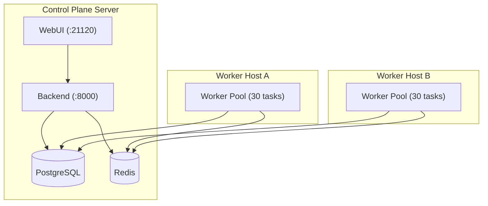

# Docker & Containers Guide

UltimaScraper provides production-grade, multi-architecture Docker images (`linux/amd64` and `linux/arm64`) built for security, isolation, and horizontal scale.

---

## Container Architecture

The Docker deployment breaks UltimaScraper down into focused, non-root, single-purpose containers. By default the `webui`, `backend` and `worker` containers all run the full image, `ghcr.io/ultimahoarder/ultimascraper/ultimascraper`, and `USR_CONTAINER_ROLE` (`webui`, `api` or `worker`) sets which part each one runs. Run on its own without a role, for example as a NAS app, the full image starts the WebUI when it has no database or Redis settings (`ULTIMA_ARCHIVE_DATABASE_URL`, `POSTGRES_HOST` or `REDIS_HOST`) and the backend otherwise. Each also has its own image (`…/backend`, `…/worker` and a much smaller `…/webui`); set `USR_BACKEND_IMAGE`, `USR_WORKER_IMAGE` or `USR_WEBUI_IMAGE` in `.env` to run a service from it:

| Container | Image Role | Default Port | Description |
|---|---|---|---|
| `webui` | WebUI Server | `21120` (host) | Serves the React interface, authenticates operators, proxies requests to backends, and coordinates remote installs over SSH. |
| `backend` | API Control Plane | `8000` (internal) | Python 3.14 FastAPI service providing REST endpoints, WebSocket telemetry, and database orchestration. |
| `worker` | Task Execution | None (worker) | Scalable scrape and download workers consuming tasks from Redis and writing through the leased database writer. |
| `postgres` | Storage Engine | `5432` (internal) | PostgreSQL 16 with pgvector (`pgvector/pgvector:pg16`), maintaining authoritative state, media ledgers, and transaction queues. |
| `redis` | Message Broker | `6379` (internal) | Redis 7 managing distributed task queues, job locks, and pub/sub events. |

---

## Selecting Components with Profiles

Every component in `docker-compose.yml` is guarded by a profile. You can select exactly which services run on a given host by defining `COMPOSE_PROFILES` in `.env`:

```env
# Run everything on a single host (Default):
COMPOSE_PROFILES=webui,backend,worker,postgres,redis

# Run only workers on a remote execution node:
COMPOSE_PROFILES=worker

# Run only the WebUI server as an access portal:
COMPOSE_PROFILES=webui
```

---

## Distributed Topologies

### Multi-Host Scaling

In high-volume environments, you can separate the control plane and database from scraping execution nodes:



To configure **Worker Host A**, set:
```env
COMPOSE_PROFILES=worker
POSTGRES_HOST=control-plane.local
REDIS_HOST=control-plane.local
POSTGRES_PASSWORD=your_secure_password
REDIS_PASSWORD=your_secure_password
# The control plane's key: docker compose exec backend cat /home/ultimascraper/.config/ultima_scraper_verse/secrets/USR_SECRET_KEY
USR_SECRET_KEY=the_control_plane_key
```

### Several Backends on One Database

Backends that share a PostgreSQL database form a cluster. Every backend and worker in it must:

- use the **same PostgreSQL database and the same Redis**;
- use the **same `USR_SECRET_KEY`**, because each one reads the secrets the others encrypted, such as auth cookies;
- have **its own `BACKEND_ID`**. The Docker default is `usr-docker` on every host, so set one for each backend you add by hand.

The first backend to start records its key in the database. A backend or worker started later with a different key refuses to start and says where to copy the right one from. Docker generates a new key on any host where `USR_SECRET_KEY` is empty, so on a second host set it to the first host's key. The WebUI installer copies the key for you when it adds a backend or worker to a cluster.

To change the key for the whole cluster, set the new key as `USR_SECRET_KEY` and the old one as `USR_SECRET_KEY_PREVIOUS` on every backend and worker, then restart them. Once one has started with the new key, any still on only the old key are refused.

### One App on a NAS (TrueNAS)

A NAS app is usually one container. Run the full image with no settings: with no database or Redis settings it starts as the WebUI.

1. Open the WebUI, create your password, and join your cluster with an invite from another WebUI.
2. On the **Cluster** page, this WebUI's host shows **Edit** under Services. Turn on **Backend**, **Workers** or both, and check the machine's address. A container cannot see that address, so the WebUI fills it in from what the cluster saw.
3. Apply. The WebUI runs them in its own container, using the database, Redis and `USR_SECRET_KEY` a backend of the cluster gives it. Each service gets the same `BACKEND_ID`, unique to this host. They start again whenever the app does, and their output appears in the app's log, prefixed `[backend]` or `[worker]`.

For other machines to use this backend, publish port `21121` as well as the WebUI's `21120`. Workers save media to the folders in the cluster's storage settings, so mount those folders into the app at the same paths. Keep the WebUI's data folder (`/data`) on a volume: it holds these settings and the services' secrets, encrypted.

---

## PostgreSQL Requirements: pgvector

UltimaScraper needs PostgreSQL 16 or newer with these extensions:

- `vector` ([pgvector](https://github.com/pgvector/pgvector))
- `pg_trgm` and `uuid-ossp`, which ship with PostgreSQL itself

The bundled `postgres` service uses `pgvector/pgvector:pg16`, the official pgvector build of PostgreSQL 16, so it already has all three. **Any other PostgreSQL needs pgvector installed, including a native server on the same host and a managed service.** The backend creates the extensions in the `public` schema when it connects. If its database user isn't allowed to create extensions, a superuser runs this once in the archive database:

```sql
CREATE EXTENSION IF NOT EXISTS vector WITH SCHEMA public;
CREATE EXTENSION IF NOT EXISTS pg_trgm WITH SCHEMA public;
CREATE EXTENSION IF NOT EXISTS "uuid-ossp" WITH SCHEMA public;
```

To check an existing server:

```sql
SELECT name, installed_version FROM pg_available_extensions WHERE name = 'vector';
```

No row means the pgvector package isn't installed on that server. An empty `installed_version` means it's installed but not yet created in this database. See [Native Development](../getting-started/native-development.md#installing-pgvector) for install commands.

---

## External PostgreSQL and Redis

If you run an existing managed PostgreSQL cluster (e.g. AWS RDS, Crunchy Data, Timescale) or an existing Redis instance, its PostgreSQL must have pgvector (see [PostgreSQL Requirements](#postgresql-requirements-pgvector)). Then:

1. Omit `postgres` and `redis` from `COMPOSE_PROFILES`:
   ```env
   COMPOSE_PROFILES=webui,backend,worker
   ```
2. Specify the external connection details in `.env`:
   ```env
   POSTGRES_HOST=db.example.internal
   POSTGRES_PORT=5432
   POSTGRES_USER=ultimascraper
   POSTGRES_PASSWORD=your_db_password
   POSTGRES_DB=ultima_archive

   REDIS_HOST=redis.example.internal
   REDIS_PORT=6379
   REDIS_PASSWORD=your_redis_password
   ```

---

## Persistence & Volume Management

UltimaScraper isolates application data, configuration, and media storage into dedicated volumes:

- **Config Volume (`usr_config`)**: Stores generated administrator tokens, encryption keys, and instance identities. **Back this volume up**.
- **Postgres Volume (`usr_postgres_data`)**: Holds all transactional database state.
- **Media Volume / Bind Mount**: Defined via `USR_STORAGE_PATH` (default `./data`), where scraped media and downloads are saved.

### Creating a Quick Backup

```bash
# Backup the PostgreSQL database
docker compose exec postgres pg_dump -U postgres ultima_archive > backup_$(date +%F).sql

# Backup encryption keys and WebUI configuration
tar -czvf usr_config_backup_$(date +%F).tar.gz -C /var/lib/docker/volumes/ultimascraper_usr_config/_data .
```
