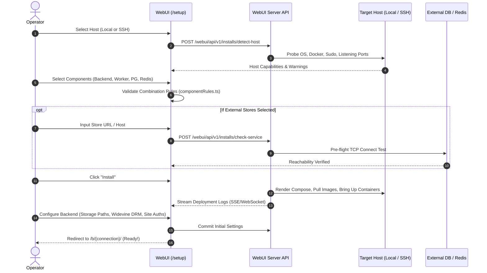

# Setup Wizard & Remote SSH Installer

UltimaScraper features a unified setup wizard and remote deployment orchestrator integrated into the WebUI server (`ultima_webui_server`). It detects target host capabilities, validates component combinations, tests database reachability before installation, deploys Docker services over SSH, and provisions backend storage, DRM, and site credentials inline.

---

## Unified Setup Wizard (`/setup`)

Opening the WebUI with no configured connections automatically redirects to `/setup` (also accessible anytime via **Manage Backends → Deploy a New Backend**).

The wizard executes a 6-stage guided workflow:



### The 6 Stages in Detail

1. **Host**: Defaults to **This machine** and automatically probes OS distribution, CPU architecture (`amd64` / `arm64`), Docker & Compose availability, sudo requirements (`none`, `passwordless`, or `password`), existing `usr-*` containers or `.usr-install.json` state, and listening ports (`5432` PostgreSQL, `6379` Redis).
   - Selecting **Another host (SSH)** reveals target connection fields, scans host keys for operator fingerprint verification, and pins the host key before any command runs.
2. **Components**: Configure modes for each of the five components according to the [Component Combinations](#component-combinations) rules below. Backend and Worker share one card: **Install here** installs both (as separate containers), **Worker only** adds a worker for a backend you already have, which is how you scale out across hosts, and **Not here** installs neither.
3. **Connections**: Displayed when PostgreSQL or Redis is set to `existing`. Includes a pre-flight **Check** button (`POST /webui/api/v1/installs/check-service`) that verifies TCP reachability from the target host before writing configuration files.
4. **Review & Install**: Summarizes the deployment topology, prompts for a sudo password only when detection indicates sudo is required, and streams installation logs in place.
5. **Configure Backend**: Seamlessly continues inline to configure media storage paths, network parameters, Widevine DRM device registration, site authentications, and WebUI hostname without redirecting to a separate screen.
6. **Done**: Automatically registers the new connection and launches `/b/{connection_id}/`.

---

## Component Combinations

Every deployment configures a mode for each component:
- **Backend & Worker**: `install` (deploy on this host) or `none` (not part of this deployment).
- **PostgreSQL & Redis**: `install` (bundled container), `existing` (reuse a service), or `none` (omitted).
- **WebUI**: `reuse` (manage from this WebUI; default) or `install` (deploy an independent WebUI container).

| Component | Rule & Constraints |
|---|---|
| **Backend** | Requires PostgreSQL **and** Redis, each either `install` or `existing`. If Backend is `install`, PG and Redis cannot be `none`. |
| **Worker** | Requires the same PostgreSQL and Redis as the backend it serves. **With Backend `install` on this host**: shares the backend's PG/Redis automatically (same `.env`). **Without a backend here** (worker-only node): joins an existing backend; PG and Redis must be `existing` and point to that backend's database and Redis. The worker's cluster identity must match the chosen backend's `cluster_id`; on a mismatch the install fails but stays listed under Deployments, so it can be repaired or uninstalled. |
| **PostgreSQL / Redis** | `install`, `existing`, or `none`. `none` is permitted only when neither Backend nor Worker is `install`. Shared database-only hosts are supported with published store ports (`docker-compose.store-ports.yml`). Repair, upgrade and uninstall keep using that override, so the ports stay published. When the install finishes, the wizard shows the host, ports, user and generated passwords other hosts enter; they are shown once and kept only in the host's `.env`. When Backend or Worker is installed on the same host, bundled ports remain private to the internal Compose bridge. |
| **WebUI** | **Local target**: Defaults to `reuse` ("this WebUI"). Installing another WebUI on the same host requires explicit confirmation. **Remote target**: Defaults to `reuse` so the remote host is managed from this primary WebUI portal. |
| **Overall** | At least one component must be `install`. Any `existing` store must pass pre-flight `check-service` verification (a 3-second TCP check run on the target) before the Install button is enabled. |

An `existing` PostgreSQL must have pgvector installed, whether it runs natively, in another container or as a managed service. The bundled PostgreSQL includes it. See [PostgreSQL Requirements](docker.md#postgresql-requirements-pgvector).

Detection offers a PostgreSQL or Redis on the host as `existing` only when the host can reach it: something listens on its port, or its container publishes the port. A container that keeps its port on its own network (another stack's bundled database) is listed as not reusable.

### Shared Rule Table and Error Codes

The combination matrix is defined in `src/UltimaScraperWeb/ultima_webui_server/installer/component_rules.json` and mirrored client-side in `componentRules.ts`. Tests on both sides check the combinations, the per-card rules and the error messages against the JSON file:

| Error Code | User-Facing Message | Condition |
|---|---|---|
| `nothing_installed` | `Choose at least one component to install.` | No component has mode `install`. |
| `postgres_required` | `Without the bundled PostgreSQL, give the database URL to use.` | Backend or Worker is `install` and PostgreSQL is `none`. |
| `redis_required` | `Without the bundled Redis, give the Redis host to use.` | Backend or Worker is `install` and Redis is `none`. |
| `worker_needs_existing_stores` | `A worker installed without a backend must use that backend's existing PostgreSQL and Redis.` | Worker is `install` while Backend is `none`, and PostgreSQL or Redis is `install`. |
| `unused_existing_store` | `Existing PostgreSQL or Redis can only be used when installing a backend or worker.` | Neither Backend nor Worker is `install`, and PostgreSQL or Redis is `existing`. |

---

## Deployment Lifecycle Operations

Installed deployments are tracked under **Deployments** on the Backends page:

- **Repair**: Restarts all stopped services, re-checks container health, and verifies API/WebSocket reachability.
- **Uninstall**: Stops and removes all containers associated with the deployment.
  - **In the WebUI**: Click **Uninstall** on the deployment card under **Deployments**. The modal provides two cleanup checkboxes:
    - **Remove `<install_dir>`**: Deletes the deployment folder (e.g. `~/ultimascraper`) and `.env`. If left unchecked, the directory and `.env` are preserved so credentials can be inspected or reused.
    - **Delete data volumes**: Executes `docker compose down --volumes` to permanently remove persistent PostgreSQL database schemas and Redis task queues. Leave unchecked to preserve databases.
    - **Password Confirmation**: Requires re-entering the WebUI administrator password for security; failed attempts count against the sign-in rate limit.
    - **SSH Key Cleanup**: If the deployment was provisioned over SSH, the WebUI automatically strips its restricted forwarding key (`ultimascraper-webui <project>`) from `~/.ssh/authorized_keys` on the remote host.
  - **Manual CLI Teardown**: If the WebUI is inaccessible, run from the target machine:
    ```bash
    cd ~/ultimascraper
    # Stop containers and network
    docker compose down --remove-orphans
    # (Optional) Drop database and redis volumes:
    docker compose down --remove-orphans --volumes
    # (Optional) Remove directory
    rm -rf ~/ultimascraper
    ```
  - **Uninstalling the WebUI Host Service**: To completely remove the standalone `ultimascraper-webui` server service, configuration, and database, see **[Uninstalling the WebUI Server](webui-server.md#uninstalling-the-webui-server)**.

---

## Automated Acceptance Testing

The installer test harness (`scripts/release/installer_acceptance.sh`) verifies installation, upgrade, repair, and uninstallation workflows against disposable test hosts:

```bash
# Run acceptance tests against Docker-in-Docker and Ubuntu containers
scripts/release/installer_acceptance.sh acceptance-smoke --hosts dind,ubuntu

# Run against a remote ARM64 machine (e.g. Raspberry Pi)
scripts/release/installer_acceptance.sh acceptance-arm64 --remote user@192.168.1.50 --remote-key ~/.ssh/id_ed25519
```
