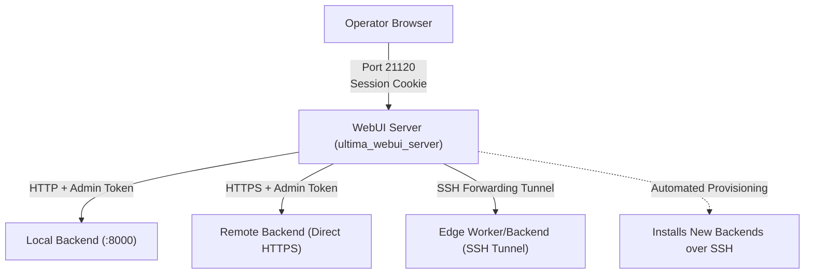

# WebUI Server Architecture & Management

The WebUI is served by `ultima_webui_server`, a purpose-built asynchronous gateway that serves the React frontend, manages operator authentication, securely stores backend connections, and proxies API/WebSocket traffic.

---

## Gateway Topology



### Security Boundary

- **No Token Exposure to Browsers**: The browser communicates solely with `ultima_webui_server` using secure, `HttpOnly`, `SameSite=Strict` session cookies. The browser never receives or stores backend administrator tokens.
- **Header Injection & Scrubbing**: When proxying requests to backends, `ultima_webui_server` injects the appropriate backend admin token into the authorization headers and strips any client-sent tokens or auth cookies.

### Host names and reverse proxies

The WebUI answers only to names an outside website cannot point at it, which stops DNS rebinding attacks:

- IP addresses, and single-label names such as `nas` or `webui`;
- this machine's own host names;
- private names: `*.localhost`, `*.local`, `*.lan`, `*.home.arpa`, `*.internal` and `*.test`.

Any other name, such as a public domain in front of a reverse proxy, gets `400` until you list it in
`USR_WEBUI_ALLOWED_HOSTS`: names separated by commas, `.example.com` for a domain and all its subdomains, or `*` to
turn the check off.

```bash
USR_WEBUI_ALLOWED_HOSTS=usr.example.com
```

Behind a reverse proxy, every browser seems to come from the proxy's address. Until a password is set, a browser
reaching the WebUI through a proxy therefore always needs the setup code from the log, unless the proxy's address is
listed in `USR_WEBUI_TRUSTED_PROXIES` (for example `127.0.0.1`). The WebUI then takes the browser's address from the
proxy's `X-Forwarded-For` header, so list only proxies you run.

---

## URL Routing Contract

| Path Pattern | Target Destination | Purpose |
|---|---|---|
| `/` | WebUI Dashboard | Root portal. If no connections are configured, automatically redirects to `/setup`. |
| `/b/{connection}/api/*` | Backend REST API | Proxies to the target backend connection specified by `{connection}`. |
| `/b/{connection}/ws/*` | Backend WebSocket | Upgrades and multiplexes live telemetry events from the specified backend. |
| `/webui/api/v1/*` | WebUI Server API | Server management: sign-in, session validation, connection registry, host detection, and SSH installer. |
| `/setup` | Unified Setup Wizard | First-run password setup, initial backend discovery, and interactive installation. |

---

## Remote SSH Deployment & Clustering

The WebUI server features an integrated SSH provisioner capable of bootstrapping new backend and worker nodes across your network:

1. In the WebUI header, select **Manage Backends** -> **Deploy New Backend**.
2. Provide the remote machine's hostname or IP, SSH port, and credentials.
3. The provisioner performs:
   - **Host Key Pinning**: Displays the SSH fingerprint for manual verification before any command executes.
   - **Automated Docker Inspection**: Verifies Docker daemon availability and architecture compatibility.
   - **Service Deployment**: Generates isolated credentials, writes `.env`, pulls release images, and brings up the backend/worker stack.
   - **Key Restriction**: Pins a single restricted SSH forwarding key in `~/.ssh/authorized_keys` for subsequent communication. Sudo passwords are used strictly in-memory during setup and discarded immediately.

### Backends other machines use (HTTPS)

A backend keeps serving plain HTTP on `CONTROL_PORT` (21121) for its own host and Compose network. To let other
machines use it, turn on **Serve HTTPS for other machines** in its **Edit config** (the `backend.share_https`
setting, with `backend.https_port`, default 8443, and an optional `backend.advertise_host`) and restart it. It then also
serves HTTPS, from every API worker, and binds the network only with `USR_ALLOW_REMOTE_BIND=true`. The self-signed
certificate is kept in the backend's config directory (`tls/`), and its SHA-256 fingerprint is reported by
`/api/v1/system/identity` and the cluster presence. Without an address set, the backend advertises its LAN address.

The environment overrides these settings, for deployments that fix them: `USR_BACKEND_TLS` (`self-signed` or `off`),
`USR_BACKEND_TLS_CERT_FILE` and `USR_BACKEND_TLS_KEY_FILE` (a certificate of your own), `CONTROL_TLS_PORT`,
`USR_ADVERTISE_HOST` and `USR_ADVERTISE_PORT`. A container cannot see its host's address or published port, so the
installer's **Let other machines use this backend** sets them in `docker-compose.backend-tls.yml`, which publishes
the HTTPS port on every interface.

WebUIs join with one-time invites (`POST /api/v1/cluster/invites`, redeemed at `POST /api/v1/cluster/join`, which
only answers over HTTPS or loopback). Each gets a `usrc_` client token that every backend on the cluster's database
accepts next to its own admin token; revoking it (`DELETE /api/v1/cluster/clients/{id}`) reaches every backend within
30 seconds. Only SHA-256 hashes of codes and tokens are stored, in `management.cluster_clients` and
`management.cluster_invites`.

---

## Updating the WebUI

**Upgrade** under Backends → Deployments updates a deployment's containers (backend, worker, PostgreSQL, Redis, and a WebUI container if that deployment has one). The WebUI you are using is separate when it was installed with `uv tool install`; it updates itself from [PyPI](https://pypi.org/project/ultima-scraper-webui-server/), where each release is published.

- The **Backends** page shows the WebUI's version and channel, and **Update to …** when a newer one is published.
- Updating installs exactly that version with `uv tool install --force`, then the WebUI starts again in its own process. The page reloads once it answers.
- `.github/workflows/webui-package.yml` publishes `ultima-scraper-webui-server` to PyPI for each release tag (`X.Y.Z`). Builds of `main` are not published there; their images are on ghcr.io as `edge`. Its `ultima-scraper-core` dependency comes from PyPI too.

Settings, from the environment:

| Variable | Purpose |
|---|---|
| `USR_WEBUI_UPDATE_INDEX` | The simple index to update from. Defaults to PyPI (`https://pypi.org/simple`). |
| `USR_WEBUI_UPDATE_CHANNEL` | `release` (only `X.Y.Z`) or `edge` (also dev builds, on an index that has them). Defaults to the channel of the running version. |
| `USR_WEBUI_UV` | The `uv` executable, when it is not on `PATH`. |
| `SSL_CERT_FILE` | A CA bundle to trust, when the index's certificate is signed by a private CA (e.g. mkcert) that is not in the system store. uv also uses the system store. |

A WebUI running in a container is updated by pulling a newer `webui` image instead; its Backends page says so.

---

## Uninstalling the WebUI Server

When you no longer need the WebUI server running on a host, remove it based on how it was installed.

### Standalone Service (`systemd` User Service + `uv`)

If the WebUI was installed directly on the host using `uv tool install` and managed via a `systemd` user service (the setup described in [`deploy/systemd/ultimascraper-webui.service`](../../deploy/systemd/ultimascraper-webui.service)):

#### 1. Stop and disable the systemd service
```bash
systemctl --user stop ultimascraper-webui
systemctl --user disable ultimascraper-webui
```

#### 2. Remove the systemd service unit
```bash
rm -f ~/.config/systemd/user/ultimascraper-webui.service
systemctl --user daemon-reload
systemctl --user reset-failed
```

#### 3. (Optional) Disable user lingering
If lingering was enabled solely to keep the WebUI running while logged out:
```bash
loginctl disable-linger "$USER"
```

#### 4. Remove the WebUI binary and virtual environment
```bash
# If installed via uv tool:
uv tool uninstall ultima-scraper-webui-server

# If installed in a dedicated venv (e.g. ~/ultimascraper-webui/uv-venv):
rm -rf ~/ultimascraper-webui
```

#### 5. Remove configuration, database, and encryption keys
The WebUI stores its runtime environment, connection registry, session database (`webui.db`), and TLS certificates in standard user directories:
```bash
# Service environment file
rm -f ~/.config/ultimascraper-webui.env

# Data directory (SQLite database, sessions, vault encryption key, self-signed TLS certs)
rm -rf ~/.local/share/UltimaScraper/webui
```
*(If you set a custom path with `USR_WEBUI_DATA_DIR` in your environment, remove that directory instead.)*

---

### Containerized WebUI

If the WebUI is running in Docker:

- **All-in-One Compose Stack**:
  ```bash
  cd <deployment-dir>
  docker compose down --remove-orphans
  ```
  *(To delete all persistent database and configuration volumes as well, add `--volumes`)*.

- **Standalone WebUI Container (`docker run`)**:
  ```bash
  docker stop usr-webui && docker rm usr-webui
  docker volume rm usr_webui
  ```
