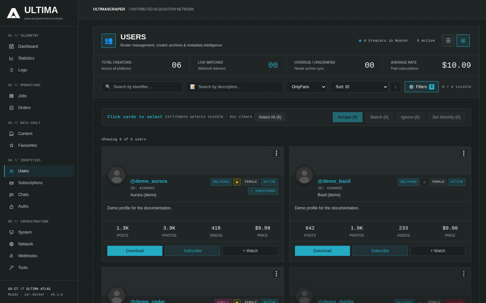

# Profiles & Authentications

UltimaScraper connects to supported platforms using authenticated user sessions or guest pools. This guide describes how to configure platform authentications, test credentials, manage performer subscriptions, and customize profile metadata.

---

## Configuring Platform Authentications

To add or update account credentials, navigate to **Settings → Authentications**.

```
┌──────────────────────────────────────────────────────────────────┐
│ Platform: [ OnlyFans ▼ ]                                         │
│ Account Label: "Main Personal Account"                           │
│ User ID (auth_id): 12345678                                      │
│ Cookie String: auth_id=12345678; sess=abcdef123456...            │
│ User Agent: Mozilla/5.0 (Windows NT 10.0; Win64; x64)...         │
│ Dynamic Token (x-bc): e7f9b8c2...                                │
│                                                                  │
│ [ Test Connection ]   [ Save Authentication ]                    │
└──────────────────────────────────────────────────────────────────┘
```

### Supported Platforms & Required Credentials

| Platform | Required Auth Fields | Extraction Method |
|---|---|---|
| **OnlyFans** | `auth_id`, `sess` (Cookie), `user_agent`, `x-bc` token | Browser DevTools (Network tab -> any `api2.onlyfans.com` request) or browser cookie export extensions. |
| **Fansly** | `token`, `user_agent` | Browser DevTools -> Application/Storage -> Local Storage (`session_token_v2`). |
| **LoyalFans** | `cookie` (Session token), `user_agent` | Browser DevTools -> Storage -> Cookies. |

### Testing Credential Validity

Always click **Test Connection** after entering credentials. The backend performs an authenticated pre-flight API handshake:
- **Active & Valid**: Displays your account username, display name, and subscription tier.
- **Expired / Expiring**: Emits an alert if session cookies have expired or two-factor authentication has been invalidated.

---

## Guest Session Pools

To protect your primary paid accounts from aggressive platform rate limits during broad catalog discovery, UltimaScraper supports **Guest Session Pools**:

- Located in **Settings → Network → Guest Session Pool**.
- Automatically rotates unauthenticated or ephemeral guest cookies when indexing public posts, free performer profiles, or search directories.
- Automatically fails over to paid session credentials only when accessing restricted paywalled content.

!!! tip "Need proxies?"
    Guest sessions and scrapes can run through proxies, which you add on the **Network** page.
    Sign up for [Webshare](https://www.webshare.io/?referral_code=s8w96gu8w77g){ rel="sponsored noopener" target="_blank" } through our
    affiliate link and you'll get **10 free proxies** to see how much they help. It also
    supports UltimaScraper.

    I've personally scraped 500 million public OnlyFans profiles in two to three months with the
    [Mass Profile Scraper](mps.md) (**Tools → Mass Profile Scraper**) and a Webshare **Shared** proxy
    server: 250 proxies, 5,000 GB bandwidth and high concurrency, for around $30.

---

## Managing Performer Profiles & Subscriptions

Navigate to **Profiles** (or **Users**) to browse creator channels:



- **Subscription Status**: Filter by *Active*, *Expired*, or *Free Following*.
- **Profile Card Actions**:
  - **Queue Scrape**: Directly submits a scraping job for the selected creator.
  - **Refresh Profile**: Fetches updated avatars, banners, bio text, and subscriber counts from the upstream API.
  - **Set Aliases & Folders**: Assign custom folder naming rules and tags to categorize creators across your media storage drives.
  - **Favourites**: Mark performers as favourites for prioritized automated sync jobs.
