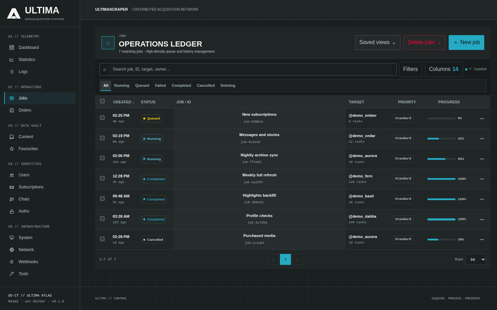

# Job Execution & Diagnostics

The **Jobs** module is the central command center for queueing scrape workflows, inspecting active worker threads, watching live download speeds, and troubleshooting failed tasks.

---

## Submitting a Scrape Job

You can initiate a job from any creator's profile page or from the **Jobs** tab:

1. Click **Queue Scrape** on a performer profile or click **New Job** in the Jobs view.
2. Configure your scraping scope:

| Scope Option | Description |
|---|---|
| **Timeline Posts** | Scrapes all public and subscriber posts from the user's primary feed. |
| **Archived Posts** | Captures older posts archived by the creator. |
| **Stories & Highlights** | Gathers ephemeral stories and pinned story highlights. |
| **Messages (DMs)** | Extracts private chat histories and purchased pay-per-view (PPV) attachments. |
| **Streams / VODs** | Captures recorded livestreams and broadcast archives. |

3. **Execution Filters**:
   - **Download Mode**: Choose *Download Media Immediately* or *Metadata Indexing Only* (indexes posts into PostgreSQL without pulling raw media files).
   - **Date Filtering**: Limit processing to posts published *Since Last Scrape* or specify a custom date window.
   - **Media Types**: Filter by Photos, Videos, Audio, or Documents.

---

## Live Telemetry & Job Statuses

The **Jobs** table provides real-time status updates powered by WebSocket event broadcasting:



```
┌───────────────────────────────────────────────────────────────────────────────────────┐
│ ID   Performer      Status      Progress         Speed        Workers    Actions      │
├───────────────────────────────────────────────────────────────────────────────────────┤
│ #42  @alice         RUNNING     [██████░░░] 68%  48.2 MB/s    12 / 16    [View] [✕]   │
│ #41  @bob           COMPLETED   [█████████] 100% 0.0 MB/s      0 / 16    [View] [↻]   │
│ #40  @carol         FAILED      [████░░░░░] 44%  0.0 MB/s      0 / 16    [Inspect]    │
└───────────────────────────────────────────────────────────────────────────────────────┘
```

### Job Lifecycle States

- **`PENDING`**: Job recorded in the execution ledger; waiting for Redis task scheduling.
- **`RUNNING`**: Worker pool is actively pulling API data, streaming media, and pushing write receipts.
- **`COMPLETED`**: All content and media have been committed to PostgreSQL and disk.
- **`FAILED`**: One or more critical tasks failed (inspectable in the diagnostics report).
- **`CANCELLED`**: Gracefully terminated by the operator.

---

## Job Diagnostics & Troubleshooting

Click **Inspect** on any completed or failed job to open the **Job Diagnostics Modal**:

- **Diagnostics Summary**: Displays total API requests made, cache hit rates, byte throughput, and average response latencies.
- **Task Error Log**: Lists specific post IDs or media download URLs that encountered HTTP 403, 404, or checksum verification failures.
- **One-Click Retry**: Click **Retry Failed Tasks** to re-queue only the unsuccessful items without repeating already completed tasks.
- **Terminal Re-conciliation**: If a worker node crashes mid-job, the supervisor automatically detects orphaned leases and transitions tasks back to the queue.
