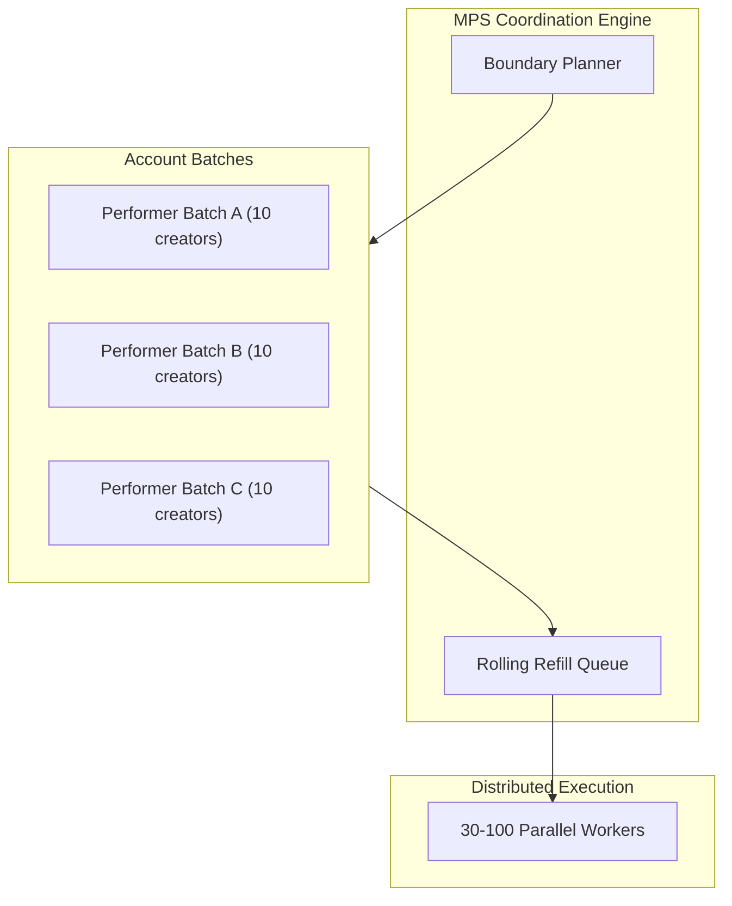

# Multi-Performer Streaming (MPS)

**Multi-Performer Streaming (MPS)** is UltimaScraper's high-throughput pipeline designed for large-scale collections archiving hundreds or thousands of creator accounts simultaneously.

---

## Why MPS?

Scraping many accounts sequentially is slow, while naively launching hundreds of uncoordinated workers can lead to IP bans, database connection exhaustion, and disk IOPS bottlenecks.

MPS solves this by introducing:
- **Rolling Refill Windows**: As fast downloads finish, new tasks refill into worker slots immediately without waiting for slower downloads to complete.
- **Boundary Discovery**: Pre-calculates post counts and pagination boundaries to avoid unnecessary HTTP polling.
- **Shared Leased Writer**: Routes all database operations through the batch writer regardless of worker count.

---

## Using the MPS Tool (`Tools → MPS Tool`)

Access the dedicated streaming dashboard at **Tools → MPS Tool**:

1. **Batch Selection**: Select performers individually or pick active subscription groups (e.g. *All Active OnlyFans Subscriptions*).
2. **Boundary Discovery Modal**:
   - Click **Discover Boundaries** to launch the boundary planner.
   - Probes earliest and latest post anchors, calculates estimated media volume, and identifies accounts requiring session re-authentication.
3. **Execution Configuration**:
   - **Worker Concurrency Budget**: Allocate between 10 and 100 parallel download streams.
   - **Refill Threshold**: Minimum number of completed tasks before triggering the next page fetch.
4. **Start Streaming**:
   - Click **Start MPS Stream**. The dashboard tracks combined network bandwidth, worker CPU utilization, and database writer commit velocity in real time.

---

## Capacity Summarization & Efficiency Monitoring

The MPS dashboard visualizes runtime efficiency metrics to help you tune your infrastructure:

- **Handoff Latency**: Time between worker task completion and write-receipt acknowledgement in Redis.
- **Rolling Refill Rate**: Number of new scrape tasks staged into Redis per minute.
- **Starvation Detection**: Emits an alert if workers are idling due to slow API pagination responses.
- **Fail-Safe Isolation**: If a single performer's account is suspended or deleted upstream, MPS isolates the failure and continues streaming the remaining accounts without stopping the job.
