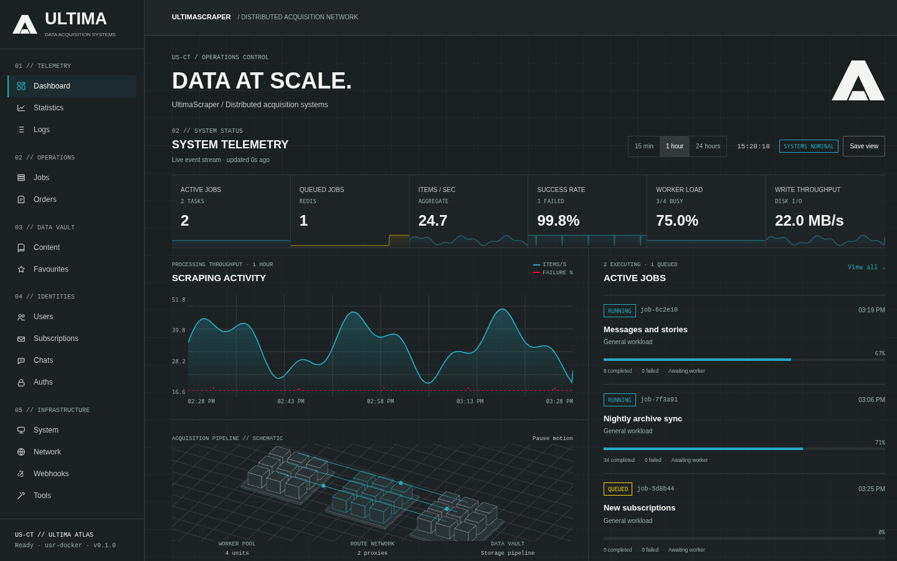
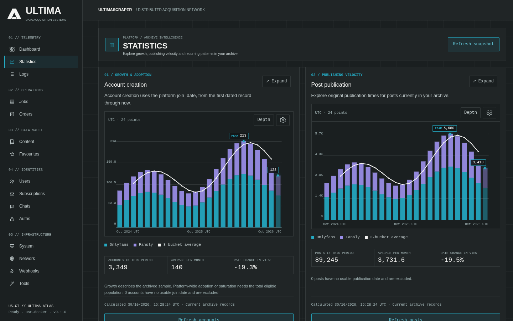
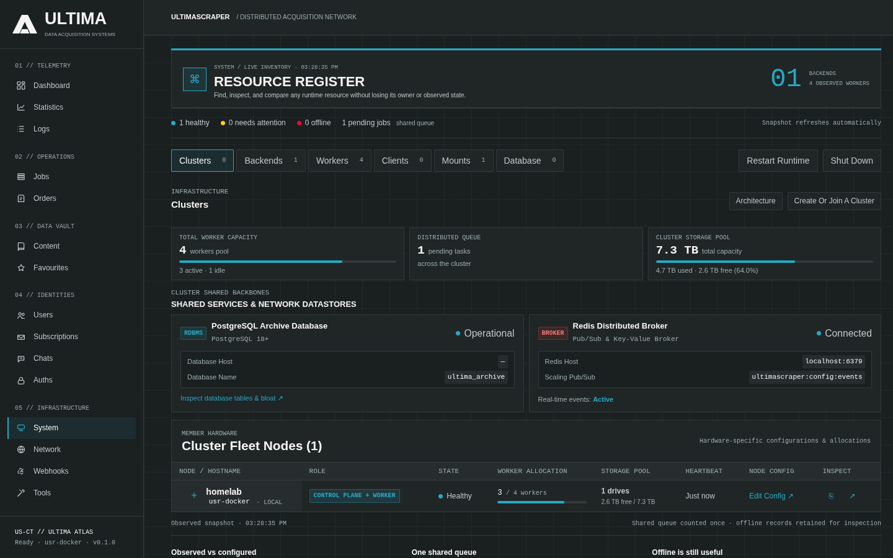

# WebUI & Multi-Backend Management

The React WebUI serves as the central control plane for UltimaScraper. It allows you to monitor scraping operations, inspect downloaded media, manage platform credentials, and toggle between multiple servers or distributed worker clusters.

---

## Terms

The WebUI uses these words for one thing each:

| Term | Means | Where |
|---|---|---|
| **Cluster** | The backends that share one PostgreSQL database, with its Redis. Even one backend is a cluster. | Cluster page |
| **Host** | A machine in a cluster. It runs **nodes**: a backend, workers, a WebUI, PostgreSQL or Redis. | Hosts list |
| **Local** | The machine this WebUI runs on. | Install |
| **Remote** | Another machine, reached over SSH. | Install |
| **Install** | Put UltimaScraper's components on a local or remote host. | Add host → Install, `/setup` |
| **Connect** | Give this WebUI a backend that is already running: its address and admin token, or a **connection ticket**. | Add host → Connect, Backends |
| **Invite** | Create a one-time **cluster invite** so another WebUI can use this cluster. | Cluster page → Invite a WebUI |
| **Join** | On that other WebUI, use the invite. | Set up → Join a cluster |

A connection ticket is for one backend and is used with **Connect**; a cluster invite is for a whole cluster and is
used with **Join**.

## Interface Layout

The sidebar groups the pages into five sections:

- **Telemetry**: Dashboard, Statistics and Logs.
- **Operations**: Jobs and Orders.
- **Data vault**: Content and Favourites.
- **Identities**: Users, Subscriptions, Chats and Auths.
- **Infrastructure**: System, Network, Webhooks and Tools.

**Statistics** charts how the archive grows: account creation, post publication, media composition and recurring patterns, per site.

**System** lists every cluster, backend, worker, mount and database the WebUI can see, with their health.

---

## Multi-Backend Switching

UltimaScraper can manage multiple independent backend instances from a single browser session:

1. **The Header Switcher**: Click the backend name in the top navigation bar to open the **Connection Switcher**.
2. **URL Scoping**: Each backend maintains its own URL namespace under `/b/{connection_id}/`:
   - `/b/default/jobs` — View jobs on your local deployment.
   - `/b/nas-server/jobs` — Instantly switch to your remote storage server.
3. **Seamless State Preservation**: The single-page application changes context instantly without requiring a full browser refresh, preserving your active filters and modal state.

---

## Backend Clusters & Failover Notice

Backends that connect to the same PostgreSQL database automatically discover each other and form a **Cluster**:

- **Cluster Grouping**: The connection menu groups nodes by cluster identity, indicating which backends share identical database state.
- **Failover Notice**: If your active backend becomes unreachable due to network disruption or maintenance, the WebUI immediately surfaces an interactive **Failover Notice**:
  > ⚠️ **Connection Lost to Primary Backend**: Clustered sibling `nas-worker-2` is online. Click **Failover** to switch your session seamlessly.

### The Clusters page

The page lists every cluster this WebUI manages, the main one opened. **Create or join a cluster**, at the top,
starts setup. Each cluster has:

- **Manage cluster:**
  - **Add host:** install on a local or remote host, or connect a running backend;
  - **Invite a WebUI**;
  - **Upgrade cluster**;
  - **Make main**.
- **Open**, for a cluster other than the one the page shows: the page then shows that one through one of its own
  backends.
- Its hosts, each with the roles it serves. **Edit** on a host this WebUI installed turns its backend, workers or
  WebUI on or off in that install. PostgreSQL and Redis stay as installed; their data is kept.

### Inviting another WebUI into a cluster

A cluster is its backends; WebUIs are clients of it. To add a WebUI on another machine:

1. On a WebUI already in the cluster, open the cluster and choose **Invite a WebUI**. The invite is copied.
2. On the other WebUI, open **Set up** (or **Create or join a cluster** on its cluster page), choose **Join a cluster** and paste it. The WebUI checks the backend's certificate
   against the invite before anything is sent, then joins.

When a backend in the cluster serves HTTPS for other machines (the installer's **Let other machines use this
backend**, or `USR_BACKEND_TLS=self-signed`), the invite is one-time: `usr://cluster/<code>@<host:port>#<fingerprint>`.
It works once, expires after a day, and holds no lasting secret. The joining WebUI gets its own credential, which
every backend in the cluster accepts, and connects to each backend that serves HTTPS, trusting only the certificate
the cluster reported for it. Each WebUI is listed under **WebUIs** in the cluster panel, where it can be revoked.
Every minute a joined WebUI adds backends that appeared, follows renewed certificates, takes the cluster's name and
checks in.

A WebUI that already reaches a backend with its admin token (for example the one its installer set up) needs no
invite: it lists itself in that cluster. Over HTTPS or on the same machine it does so directly. Over plain HTTP it
does so through a backend the cluster reports serving HTTPS, trusting the certificate fingerprint the cluster reports
for it, and checks in there from then on. It tries again every ten minutes until it is listed, so it follows a
backend that starts serving HTTPS later.

Without an HTTPS backend, the invite falls back to carrying the backends' admin tokens, and the panel says so:
share that one only over a channel you trust.

A page talks to the backend it was opened on; when that backend goes down, writes do not move to another one.

---

## Managing Connections & Deployments

Click **Manage Backends** in the connection dropdown to access the backend registry:

- **Add Existing Backend**: Connect to an already running UltimaScraper server by providing its base URL and administrative bearer token.
- **Deploy New Backend**: Launch the integrated SSH provisioner to install new backend and worker containers on any remote machine across your local network.
- **Health Indicators**: Real-time round-trip latency, active worker counts, and Redis heartbeat status are displayed for every registered host.
